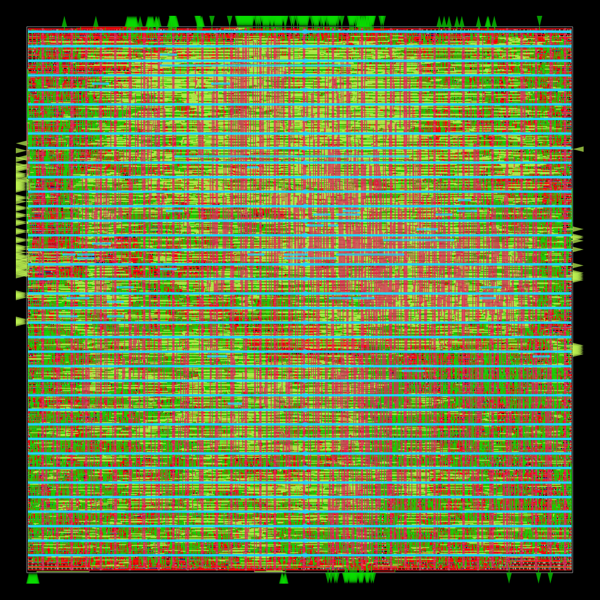
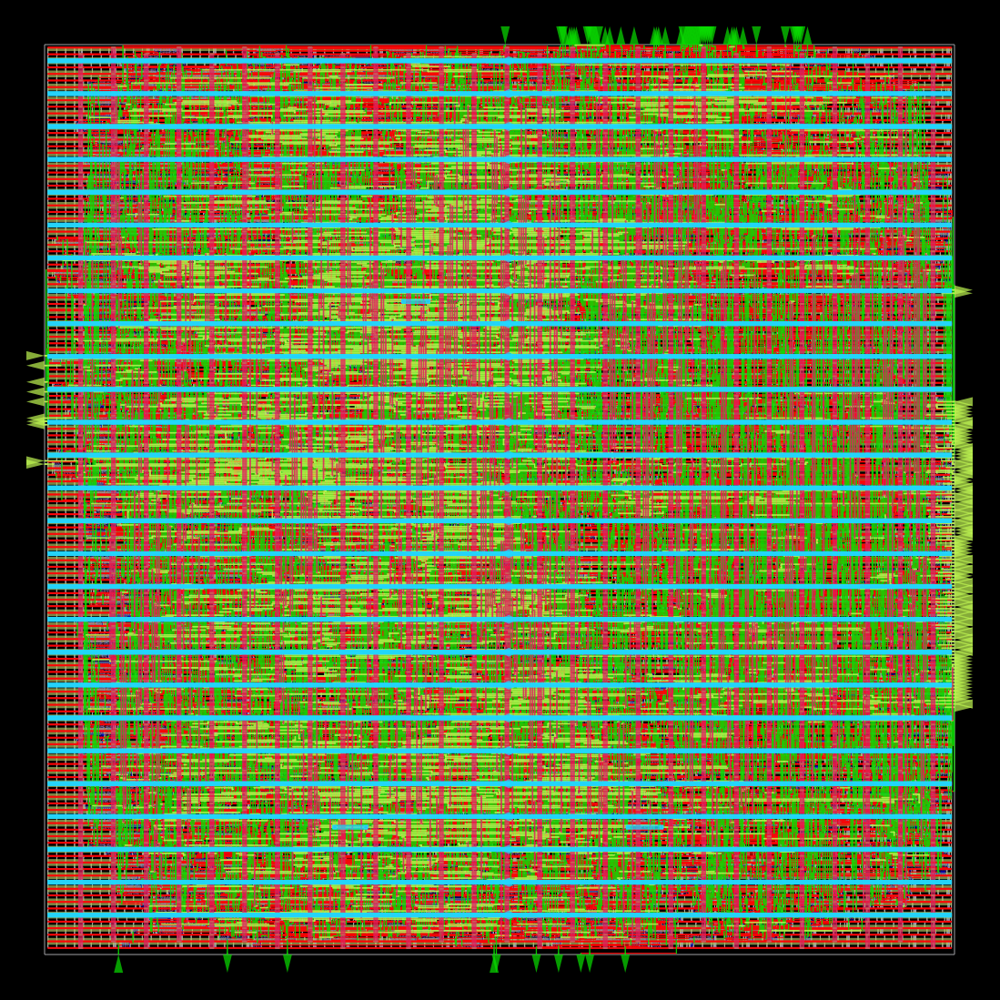

# Automated RTL-to-GDSII Physical Implementation of RISC-V Cores (SkyWater 130nm)

This repository contains physical implementation deliverables and sign-off metrics for two 32-bit RISC-V cores (**Ibex RV32IMC** and **riscv32i**) using **OpenROAD Flow Scripts (ORFS)** on the **SkyWater 130nm (`sky130hd`)** open-source PDK.

---

## Sign-off Comparison Metrics

| Specification / Metric | Ibex Core (RV32IMC) | RISCV-32I Core |
| :--- | :--- | :--- |
| **Technology PDK** | SkyWater 130nm (`sky130hd`) | SkyWater 130nm (`sky130hd`) |
| **Flow Infrastructure** | OpenROAD, Yosys, TritonRoute | OpenROAD, Yosys, TritonRoute |
| **Max Clock Frequency ($F_{\max}$)** | **117.78 MHz** (Min Period: 8.49 ns) | **158.86 MHz** (Min Period: 6.29 ns) |
| **Worst Negative Slack (WNS)** | -0.55 ns | -0.47 ns |
| **Total Negative Slack (TNS)** | -321.74 ns | -35.47 ns |
| **Total Power Dissipation** | **65.5 mW** | **24.7 mW** |
| **Routing DRC Violations** | **0** | **0** |
| **Electrical Rule Violations** | 0 (Max Slew / Cap / Hold) | 0 (Max Slew / Cap / Hold) |

---

## Physical Layouts

### Ibex Core Layout

### RISCV-32I Core Layout

---

## Implementation Stages
1. **Logic Synthesis:** Yosys synthesis mapping to `sky130_fd_sc_hd` standard cell library.
2. **Floorplanning & PDN:** Core ring and power mesh distribution.
3. **Placement:** Global placement, timing optimization, and detailed placement.
4. **Clock Tree Synthesis (CTS):** Clock buffer tree synthesis with balanced skew.
5. **Detailed Routing:** TritonRoute detailed routing with 0 DRC violations.
6. **Sign-off STA:** Setup/hold timing, transition/capacitance rule verification.
